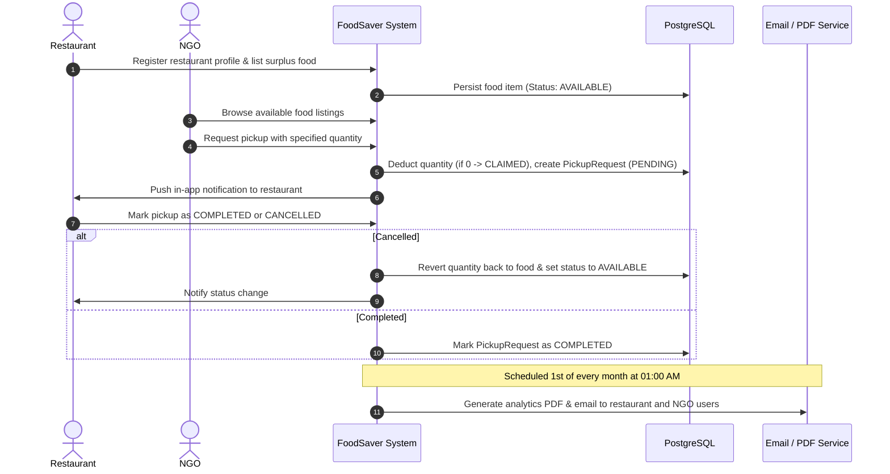
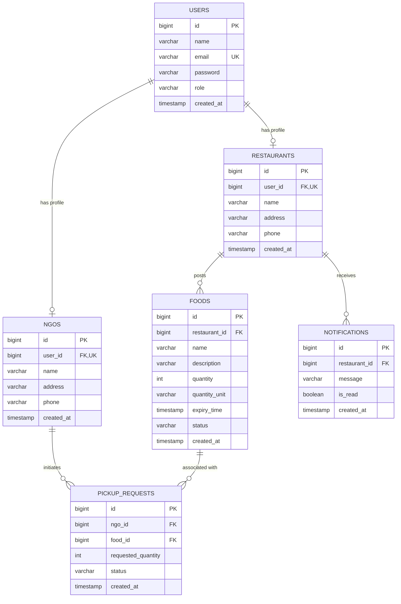

**FoodSaver App** is a mission-driven Spring Boot RESTful platform built to tackle food waste by bridging the gap between food donors (restaurants, caterers, eateries) and Non-Governmental Organizations (NGOs). Restaurants post surplus food; NGOs claim and schedule pickups; automated real-time notifications and monthly PDF reports ensure transparency and accountability.

---

## 📋 Table of Contents

- [Overview & Workflow](#-overview--workflow)
- [Key Features](#-key-features)
- [Architecture & Tech Stack](#-architecture--tech-stack)
- [Database Schema & ER Diagram](#-database-schema--er-diagram)
- [API Reference](#-api-reference)
  - [Authentication & Users](#1-authentication--users)
  - [Restaurant Management](#2-restaurant-management)
  - [NGO Management](#3-ngo-management)
  - [Food Donations](#4-food-donations)
  - [Pickup Requests & Workflow](#5-pickup-requests--workflow)
  - [Notifications](#6-notifications)
  - [Analytics & Reports](#7-analytics--reports)
- [Environment Variables](#-environment-variables)
- [Getting Started](#-getting-started)
  - [Prerequisites](#prerequisites)
  - [Local Installation](#local-installation)
  - [Running with Docker](#running-with-docker)
- [Testing & Code Coverage](#-testing--code-coverage)
- [Deployment](#-deployment)
- [Project Structure](#-project-structure)

---

## 🔄 Overview & Workflow

Food waste is one of the world's most pressing environmental and humanitarian challenges. **FoodSaver App** simplifies surplus food redistribution through a structured, multi-role lifecycle:



---

## ✨ Key Features

- **🔐 Dual-Role Access Control**: Distinct roles (`RESTAURANT`, `NGO`) with secure BCrypt password hashing.
- **🥘 Real-Time Inventory & Availability**:
  - Restaurants post food donations with quantities, units (e.g., `kg`, `servings`, `boxes`), descriptions, and expiration timestamps.
  - Automatic status updates (`AVAILABLE`, `CLAIMED`, `EXPIRED`).
- **📦 Reliable Pickup Management**:
  - NGOs can reserve partial or complete quantities of listed food items.
  - Safe rollback: if a pickup is cancelled, reserved quantities are automatically restored to the donation.
- **🔔 Notification Engine**:
  - In-app notification triggers whenever an NGO requests or cancels a pickup.
  - Read/unread status tracking for restaurants.
- **📊 Comprehensive Analytics**:
  - Metric breakdowns by units (e.g., total posted, claimed, completed).
  - Breakdown of active, claimed, expired, pending, and completed donations.
- **📄 Automated Monthly PDF Email Reports**:
  - Runs automatically on the 1st of every month at 1:00 AM (`@Scheduled(cron = "0 0 1 1 * ?")`).
  - Creates formatted PDF summary reports using **OpenPDF**.
  - Sends emails with PDF attachments via **Spring Mail** (SMTP).
  - On-demand trigger endpoint (`GET /analytics/trigger-report`) for testing and manual dispatch.
- **🧪 Thorough Test Suite**:
  - Comprehensive unit and integration tests using MockMvc, JUnit 5, and in-memory H2 database.
  - JaCoCo code coverage plugin configured in Maven.

---

## 🛠 Architecture & Tech Stack

| Layer / Component | Technology | Description |
| :--- | :--- | :--- |
| **Language** | Java 17 | Core platform language |
| **Framework** | Spring Boot 4.0.6 | REST API framework, dependency injection |
| **Persistence** | Spring Data JPA / Hibernate | Object-Relational Mapping (ORM) |
| **Database** | PostgreSQL | Primary production/dev relational database |
| **Test Database**| H2 In-Memory DB | Isolated database for unit & integration testing |
| **Security** | Spring Security | Password hashing with `BCryptPasswordEncoder`, CORS |
| **PDF Generation**| OpenPDF (LibrePDF 1.3.30) | Programmatic PDF report generator |
| **Email Service**| Spring Boot Starter Mail | SMTP client for automated PDF delivery |
| **Testing** | JUnit 5, MockMvc, JaCoCo | Automated testing and code coverage reporting |
| **Containerization**| Docker (Multi-stage build) | Production runtime packaging on Alpine JRE 17 |
| **CI/CD** | GitHub Actions | Automated build, test, and artifact packaging |
| **Cloud Deployment**| AWS ECS (Fargate) | Container task definition ready |

---

## 🗄 Database Schema & ER Diagram



---

## 📡 API Reference

Base URL: `http://localhost:8080`

### 1. Authentication & Users

#### Register User
`POST /register`
```json
{
  "name": "Jane Doe",
  "email": "jane@example.com",
  "password": "securePassword123",
  "role": "RESTAURANT" // Options: "RESTAURANT", "NGO"
}
```
**Response (201 Created):**
```json
{
  "message": "User registered successfully",
  "userId": 1
}
```

#### User Login
`POST /login`
```json
{
  "email": "jane@example.com",
  "password": "securePassword123"
}
```
**Response (200 OK):**
```json
{
  "userId": 1,
  "restaurantId": 1,
  "ngoId": null,
  "message": "Login successful",
  "name": "Jane Doe",
  "email": "jane@example.com",
  "role": "RESTAURANT"
}
```

#### User Logout
`POST /logout`
```json
// Response (200 OK): "Logged out successfully"
```

---

### 2. Restaurant Management

#### Register Restaurant Profile
`POST /register/restaurant`
```json
{
  "userId": 1,
  "name": "Green Garden Bistro",
  "address": "123 Main St, Springfield",
  "phone": "+1-555-0199"
}
```
**Response (201 Created):**
```json
{
  "message": "Restaurant registered successfully",
  "restaurantId": 1
}
```

#### Get All Restaurants
`GET /restaurants`
- Returns a list of all registered restaurant profiles.

#### View Pickups for a Restaurant
`GET /restaurants/{restaurantId}/pickups`
- Returns all pickup requests created for food donations made by this restaurant.

---

### 3. NGO Management

#### Register NGO Profile
`POST /register/ngo`
```json
{
  "userId": 2,
  "name": "City Food Rescue NGO",
  "address": "456 Hope Ave, Springfield",
  "phone": "+1-555-0288"
}
```
**Response (201 Created):**
```json
{
  "message": "NGO registered successfully",
  "ngoId": 1
}
```

#### Get All NGOs
`GET /ngos`
- Returns a list of all registered NGOs.

#### View Pickups by an NGO
`GET /ngo/{ngoId}/pickups`
- Returns all pickup requests requested by this NGO.

---

### 4. Food Donations

#### Add Food Donation
`POST /food`
```json
{
  "restaurantId": 1,
  "name": "Fresh Pasta and Bread",
  "description": "Leftover tray of baked ziti and 10 fresh bread loaves",
  "quantity": 10,
  "quantityUnit": "boxes",
  "expiryTime": "2026-11-10T20:00:00"
}
```
**Response (201 Created):**
```json
{
  "id": 1,
  "restaurantId": 1,
  "restaurantName": "Green Garden Bistro",
  "name": "Fresh Pasta and Bread",
  "description": "Leftover tray of baked ziti and 10 fresh bread loaves",
  "quantity": 10,
  "quantityUnit": "boxes",
  "expiryTime": "2026-11-10T20:00:00",
  "status": "AVAILABLE",
  "createdAt": "2026-11-07T21:00:00"
}
```

#### Get All Available Food
`GET /food`
- Retrieves all currently available food donations across all restaurants.

#### Get Food by Restaurant
`GET /restaurants/{restaurantId}/food`
- Retrieves all food donations created by the specified restaurant.

---

### 5. Pickup Requests & Workflow

#### Request Pickup (NGO)
`POST /ngo/pickup`
```json
{
  "ngoId": 1,
  "foodId": 1,
  "requestedQuantity": 4
}
```
**Response (201 Created):**
```json
{
  "id": 1,
  "ngoId": 1,
  "ngoName": "City Food Rescue NGO",
  "foodId": 1,
  "foodName": "Fresh Pasta and Bread",
  "restaurantName": "Green Garden Bistro",
  "requestedQuantity": 4,
  "quantityUnit": "boxes",
  "status": "PENDING",
  "createdAt": "2026-11-07T21:15:00"
}
```

#### Restaurant Updates Pickup Status
`PUT /restaurants/{restaurantId}/pickups/{pickupId}/status?status=COMPLETED`
- Status parameter: `COMPLETED` or `CANCELLED`.
- *Note:* If cancelled by the restaurant, the reserved food quantity is automatically returned to the inventory.

#### NGO Cancels Pickup Request
`PUT /ngo/{ngoId}/pickups/{pickupId}/status?status=CANCELLED`
- Status parameter must be `CANCELLED`.
- Restores food quantity and notifies the restaurant.

---

### 6. Notifications

#### Get Notifications for Restaurant
`GET /restaurants/{restaurantId}/notifications`
- Returns all notifications for the restaurant (e.g., when an NGO claims or cancels a pickup).

#### Mark Notification as Read
`PUT /notifications/{notificationId}/read`
- Marks the notification as read (`isRead: true`).

---

### 7. Analytics & Reports

#### Restaurant Analytics
`GET /restaurants/{restaurantId}/analytics`
**Response (200 OK):**
```json
{
  "restaurantId": 1,
  "restaurantName": "Green Garden Bistro",
  "totalDonationsCount": 15,
  "activeDonationsCount": 3,
  "claimedDonationsCount": 10,
  "expiredDonationsCount": 2,
  "totalQuantityPostedByUnit": { "boxes": 45, "kg": 20 },
  "totalQuantityClaimedByUnit": { "boxes": 30, "kg": 15 },
  "totalQuantityCompletedByUnit": { "boxes": 28, "kg": 15 },
  "totalPickupsReceived": 12,
  "pendingPickupsCount": 2,
  "completedPickupsCount": 9,
  "cancelledPickupsCount": 1
}
```

#### NGO Analytics
`GET /ngo/{ngoId}/analytics`
**Response (200 OK):**
```json
{
  "ngoId": 1,
  "ngoName": "City Food Rescue NGO",
  "totalPickupsRequested": 8,
  "pendingPickupsCount": 1,
  "completedPickupsCount": 6,
  "cancelledPickupsCount": 1,
  "totalQuantityClaimedByUnit": { "boxes": 25 },
  "totalQuantityCompletedByUnit": { "boxes": 20 }
}
```

#### Manually Trigger Monthly PDF Reports
`GET /analytics/trigger-report`
- Instantly generates PDF reports for all registered restaurants and NGOs and sends them via email.

---

## ⚙️ Environment Variables

The application relies on environment variables defined in [`application.properties`](file:///Users/shreeprabha/Documents/code/foodSaverApp/src/main/resources/application.properties):

| Variable | Description | Example / Default |
| :--- | :--- | :--- |
| `SPRING_DATASOURCE_URL` | JDBC URL for PostgreSQL database | `jdbc:postgresql://localhost:5432/foodsaver` |
| `SPRING_DATASOURCE_USERNAME` | PostgreSQL username | `postgres` |
| `SPRING_DATASOURCE_PASSWORD` | PostgreSQL password | `postgres` |
| `SPRING_MAIL_USERNAME` | SMTP email address (Gmail) | `your-email@gmail.com` |
| `SPRING_MAIL_PASSWORD` | SMTP App password (Gmail) | `your-app-password` |

---

## 🚀 Getting Started

### Prerequisites
- **JDK 17** or later installed
- **Maven 3.8+** (or use the included `./mvnw` wrapper)
- **PostgreSQL 13+** installed and running
- **Docker** (optional, for containerized run)

### Local Installation

1. **Clone the repository:**
   ```bash
   git clone https://github.com/your-username/foodSaverApp.git
   cd foodSaverApp
   ```

2. **Set up PostgreSQL database:**
   ```sql
   CREATE DATABASE foodsaver;
   ```

3. **Export required environment variables:**
   ```bash
   export SPRING_DATASOURCE_URL=jdbc:postgresql://localhost:5432/foodsaver
   export SPRING_DATASOURCE_USERNAME=postgres
   export SPRING_DATASOURCE_PASSWORD=your_db_password
   export SPRING_MAIL_USERNAME=your_email@gmail.com
   export SPRING_MAIL_PASSWORD=your_email_app_password
   ```

4. **Build the application:**
   ```bash
   ./mvnw clean package
   ```

5. **Run the application:**
   ```bash
   ./mvnw spring-boot:run
   ```
   The server will start on port `8080`.

---

### Running with Docker

FoodSaver includes a multi-stage `Dockerfile`:

1. **Build Docker image:**
   ```bash
   docker build -t foodsaver-app:latest .
   ```

2. **Run container:**
   ```bash
   docker run -p 8080:8080 \
     -e SPRING_DATASOURCE_URL=jdbc:postgresql://host.docker.internal:5432/foodsaver \
     -e SPRING_DATASOURCE_USERNAME=postgres \
     -e SPRING_DATASOURCE_PASSWORD=your_password \
     -e SPRING_MAIL_USERNAME=your_email@gmail.com \
     -e SPRING_MAIL_PASSWORD=your_email_app_password \
     foodsaver-app:latest
   ```

---

## 🧪 Testing & Code Coverage

The project uses JUnit 5, MockMvc, and H2 in-memory database for tests so that no external database is needed during test execution.

- **Run all tests:**
  ```bash
  ./mvnw test
  ```

- **Run tests & generate JaCoCo code coverage report:**
  ```bash
  ./mvnw clean verify
  ```
  Once the build completes, view the JaCoCo report in your browser:
  ```bash
  open target/site/jacoco/index.html
  ```

---

## ☁️ Deployment

### Continuous Integration (CI)
GitHub Actions workflow is located at [`.github/workflows/ci.yml`](file:///Users/shreeprabha/Documents/code/foodSaverApp/.github/workflows/ci.yml):
- Runs on every `push` and `pull_request` to `main`.
- Validates code compilation, executes test suites, and archives the build JAR artifact and JaCoCo coverage report.

### AWS ECS Fargate
An AWS task definition template is pre-configured at [`.aws/task-definition.json`](file:///Users/shreeprabha/Documents/code/foodSaverApp/.aws/task-definition.json) for easy deployment into Amazon Elastic Container Service (ECS) with AWS Fargate.

---

## 📁 Project Structure

```text
foodSaverApp/
├── .aws/
│   └── task-definition.json       # AWS ECS Fargate task specification
├── .github/
│   └── workflows/ci.yml           # GitHub Actions CI build & test workflow
├── src/
│   ├── main/
│   │   ├── java/com/agile/processes/foodSaverApp/
│   │   │   ├── config/            # Security & CORS configuration
│   │   │   ├── controllers/       # REST Controllers (Food, NGO, Restaurant, User, etc.)
│   │   │   ├── dtos/              # Data Transfer Objects & validation annotations
│   │   │   ├── entities/          # JPA Entities (User, Restaurant, NGO, Food, Pickup)
│   │   │   ├── enums/             # Enums (Role, FoodStatus, PickupStatus)
│   │   │   ├── exceptions/        # Global exception handler & error mapping
│   │   │   ├── repository/        # Spring Data JPA repositories
│   │   │   ├── services/          # Business logic, PDF generator, email & scheduled reports
│   │   │   └── FoodSaverAppApplication.java
│   │   └── resources/
│   │       └── application.properties # App configuration & datasource properties
│   └── test/                      # Unit & integration tests (MockMvc, H2)
├── Dockerfile                     # Multi-stage production container build
├── pom.xml                        # Maven dependencies & build plugins
└── README.md                      # Project documentation
```

---


